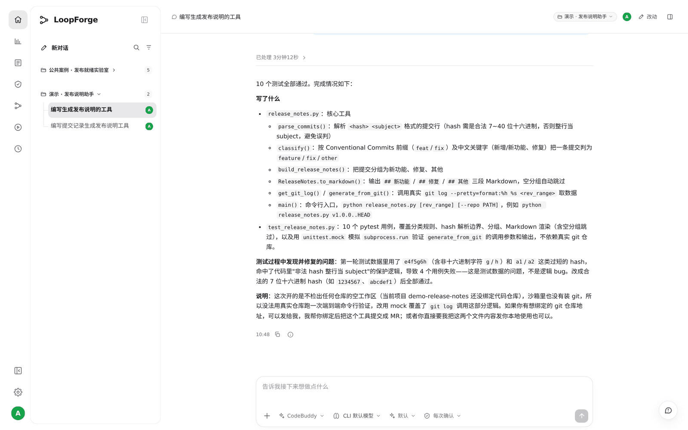
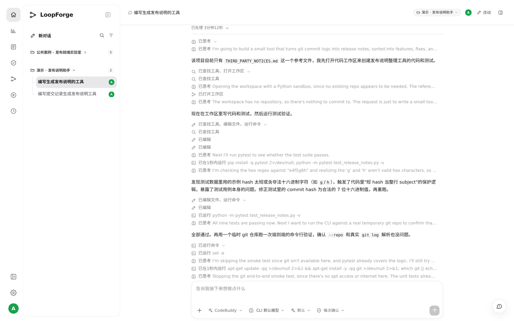
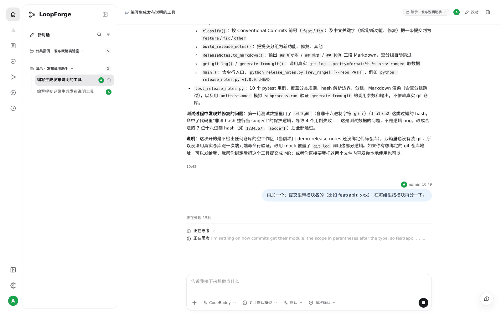
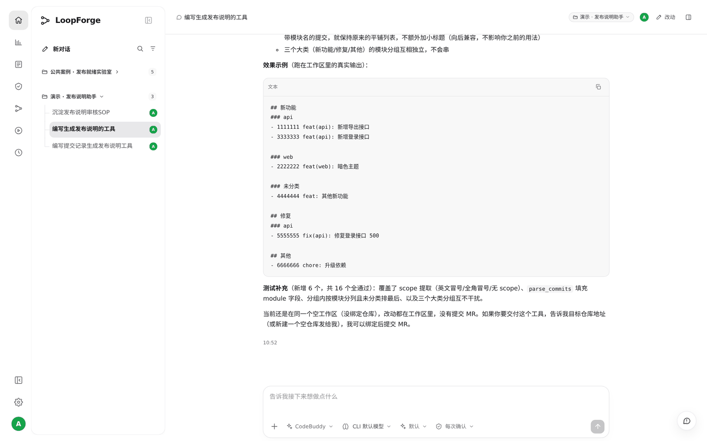

# S01 · 在云端让 AI 写个小工具

> **真实场景 · S01** · 一句话说需求，AI 在云端工作区里写代码、跑测试。发完就可以关电脑，云端依然在跑。

## 能帮你什么

* **不占你的电脑**：代码在平台的云端沙箱里写、在里面跑测试。
* **关机了也在跑**：发完消息就可以合上电脑，回来打开同一个会话就能看到结果。
* **过程看得见**：打开了什么、改了哪些文件、跑了什么命令，每一步都留在会话里。
* **说得很短也行**：AI 会自己补全细节，遇到问题自己修，修不了会问你。

## 怎么用

### 1. 直接说你要什么

新建对话，我们实际发的就是这一句：

```text
帮我写个小工具，把 git 提交记录整理成发布说明：新功能、修复、其他分开列，
写几个测试跑一下。
```

AI 会打开一个云端工作区，写代码、写测试、运行。跑测试时它发现自己的测试数据有问题，改完重跑，最后 10 个测试全部通过。





点开消息上方的 **「已处理 3分钟12秒」**，可以看到它每一步做了什么：打开工作区、编辑文件、运行 `pytest`、修复后重跑。





### 2. 接着提要求，然后关掉电脑

想再加功能，在同一个会话里接着说：

```text
再加一个：提交里带模块名的（比如 feat(api): xxx），在每组里按模块再分一下。
```

我们发完这句就 **直接关掉了浏览器**。





几分钟后重新打开同一个会话：AI 在云端继续做完了，用时 2 分 47 秒，16 个测试全部通过，还给出了真实运行的输出示例。





## 适合什么时候用

* 想快速做个脚本、小工具、原型，不想在本地配环境。
* 任务要跑一会儿，不想一直守着。
* 想把过程留下来，之后自己或同事能回看。

## 实测

| 项目 | 结果 |
| --- | --- |
| 第一句需求 | 3 分 12 秒，`release_notes.py` + 10 个测试全部通过 |
| 追加需求（发完即关浏览器） | 2 分 47 秒在云端做完，测试增加到 16 个，全部通过 |
| 运行环境 | 项目里的 Python 3.11 Docker 沙箱，没有接代码仓库 |

## 注意

* **新项目要先有一个沙箱**。没有时 AI 会告诉你"项目里没有可用的沙箱"。可以直接让它配：「先不绑仓库，你帮我在这个项目配一个能跑 Python 的沙箱」，它会弹出确认卡片，你确认即可。我们实测时 AI 第一次漏填了沙箱类型，回一句「driver 用 docker 再提交一次」就好了。
* 没接代码仓库时，文件只在这次的工作区里，不会提交到任何地方。要正式提交，先给项目接仓库。

---

← 上一篇：[场景总览](00-overview.md) | [返回文档总目录](../README.md) | 下一篇：[S02 · 和同事在同一个会话里接力](02-shared-session-handoff.md) →
