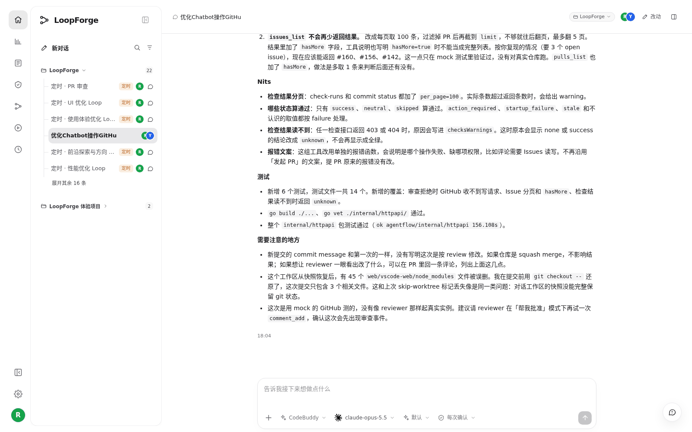

# S02 · 和同事在同一个会话里接力

> **真实场景 · S02** · 需求讨论、实现和 Review 都在同一个会话里，接手的人直接看历史，不用重新讲背景。

## 能帮你什么

* **上下文不丢**：前面聊过什么、改过什么、测过什么，都在同一份历史里。
* **谁都能接着做**：同事用自己的账号打开同一个会话，直接接着说。
* **结果连在一起**：同一个需求、同一个分支、同一个 PR，不会散成好几处。

## 真实案例

> 这个场景需要两个真人，演示项目里没法一个人演，所以这里用的是 **LoopForge 团队自己项目里的一段真实会话**。

两位成员在同一个会话里接力"优化 Main Bot 操作 GitHub"：

1. **成员 A** 提出问题：Main Bot 操作 GitHub 必须先开工作区，太重。
2. **成员 B** 打开同一个会话，确认范围，让 AI 提交 PR。
3. AI 实现并测试，提交了 [PR #159](https://github.com/Tencent/LoopForge/pull/159)。
4. 成员 B 把实测发现的问题贴回会话，AI 在同一个分支上修复。





## 怎么用

1. 项目负责人在 **设置 → 项目配置 → 项目成员** 里把同事加进来。
2. 把会话链接发给同事，同事用 **自己的账号** 打开。
3. 同事直接接着说，例如（示例写法）：

```text
我接着做这个。review 意见贴在下面了，在原来的分支上改，改完跑一下测试。
```

## 适合什么时候用

* 一个需求要好几个人分阶段推进：提需求的、实现的、做 Review 的。
* 有人请假或换班，需要别人接手。

## 注意

* 出现"会话已更新"的提示时，先刷新再发，避免和同事的消息冲突。
* 后续修改继续在原会话、原需求、原 PR 里推进，不要另开新单。
* PR 提交了不等于交付了，以合并和验收为准。

---

← 上一篇：[S01 · 在云端让 AI 写个小工具](01-cloud-first-tool.md) | [返回文档总目录](../README.md) | 下一篇：[S03 · 把好用的做法存成团队资产](03-save-team-assets.md) →
