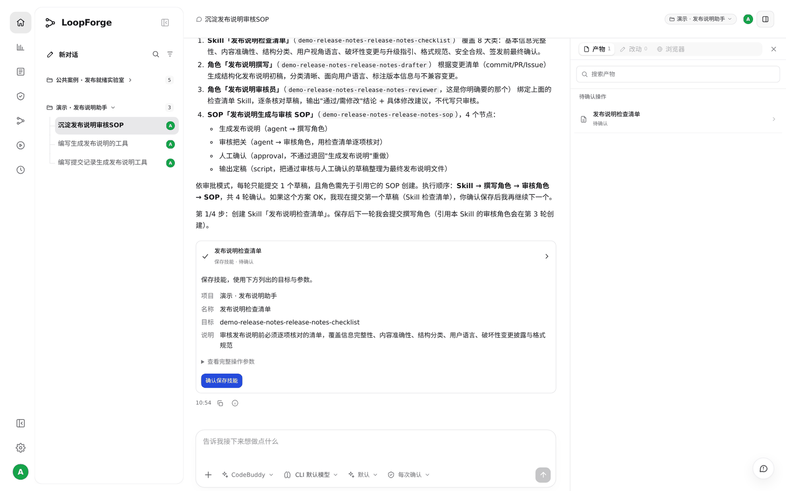
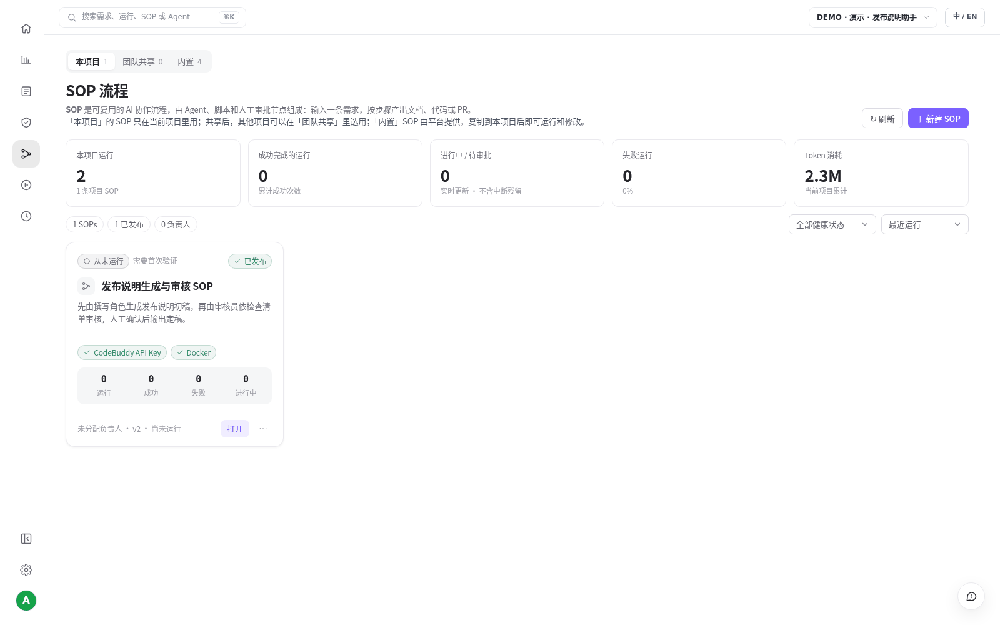
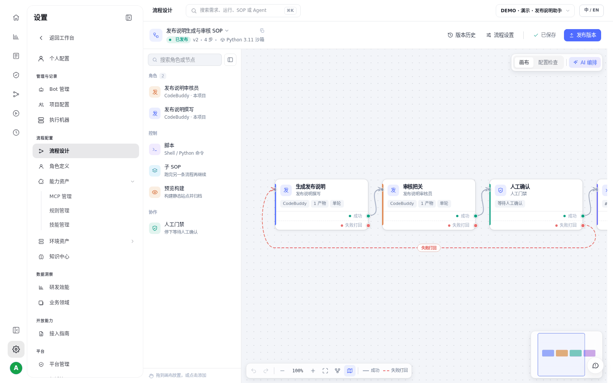

# S03 · 把好用的做法存成团队资产

> **真实场景 · S03** · 用一段话让 AI 把"谁来做、按什么查、按什么顺序"存成角色、检查清单和 SOP，团队里谁都能直接复用。

## 能帮你什么

* **不用每次粘长提示词**：角色的职责、检查的标准、流程的步骤存一次，之后直接用。
* **团队标准一致**：大家用同一份检查清单、同一条流程，结果可比。
* **在对话里就能建**：不用学流程编辑器，说清楚要什么，AI 帮你建好，你确认即可。

| 资产 | 回答的问题 | 本例 |
| --- | --- | --- |
| **角色** | 谁来做、能做什么 | 发布说明撰写、发布说明审核员 |
| **Skill** | 按什么标准检查 | 发布说明检查清单 |
| **SOP** | 按什么顺序做 | 生成 → 审核 → 人工确认 → 输出定稿 |

## 怎么用

### 1. 说清楚想沉淀什么

在 S01 做完工具后，新开一个对话，我们发的是：

```text
这个发布说明工具挺好用，帮我沉淀成团队能复用的东西：一个专门审发布说明的角色、
一份检查清单（Skill），再做一个 SOP：先生成发布说明，然后人工确认，最后输出定稿。
```

AI 先给出方案：1 个 Skill、2 个角色（撰写和审核）、1 条 4 个节点的 SOP，然后按顺序一项一项提交，每一项都弹出确认卡片。





依次点 **确认**：检查清单 → 撰写角色 → 审核角色 → SOP，一共 4 次。

### 2. 发布 SOP

SOP 保存后是草稿，要发布才能被运行和定时调用。我们只回了两个字：

```text
发布吧。
```

确认后，**流程模板** 里就能看到这条 SOP，状态是「已发布」：





点 **打开** 可以看到流程图：审核没通过会打回重写。





## 适合什么时候用

* 你发现某种做法反复用、效果好，想让团队都按这个来。
* 新人加入，希望直接用团队的标准，而不是从头摸索。

## 实测

| 项目 | 结果 |
| --- | --- |
| 对话 | 2 句话，5 次确认（4 项资产 + 发布） |
| 产出 | 1 个 Skill、2 个角色、1 条 SOP（v2，已发布） |

## 注意

* 每次确认只执行一项，AI 会告诉你现在是第几步。
* SOP 默认用平台的 `generic-docker` 沙箱。如果 SOP 里有 AI 节点，不要换成只装了 Python 的沙箱，否则会因为找不到 AI 执行器而失败（S05 里就遇到了，AI 自己查出并修好了）。

---

← 上一篇：[S02 · 和同事在同一个会话里接力](02-shared-session-handoff.md) | [返回文档总目录](../README.md) | 下一篇：[S04 · 用 @ 调用团队资产](04-mention-assets.md) →
