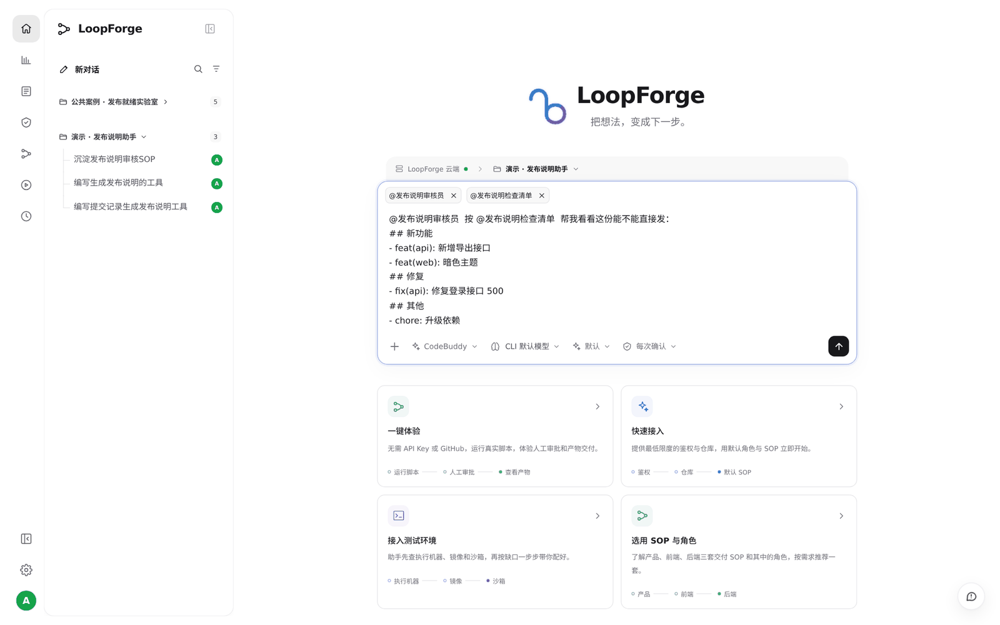
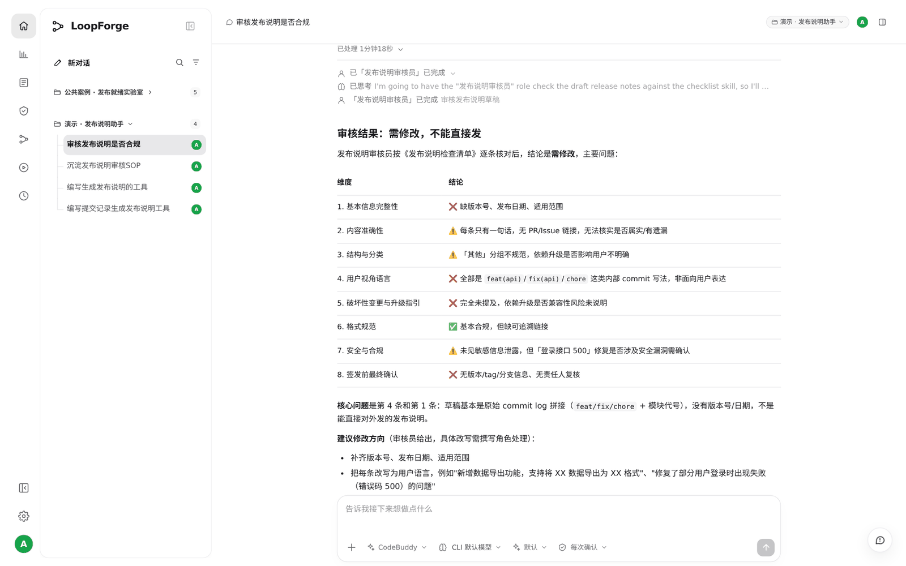

# S04 · 用 @ 调用团队资产

> **真实场景 · S04** · 输入 @ 选中团队的角色和检查清单，让它按团队标准办事；结论每一条都有依据。

## 能帮你什么

* **一个 @ 代替一大段说明**：角色的职责和检查标准已经存好了，@ 一下就带上。
* **真的是那个角色在做**：会话里能看到「发布说明审核员」被调用并完成，不是主 AI 模仿语气。
* **按标准逐条给结论**：哪条过、哪条不过、为什么，一目了然。

## 怎么用

### 1. 输入 @，选角色和清单

在输入框里打 `@发布说明`，会弹出项目里的角色、Skill 和 SOP。依次选中「发布说明审核员」和「发布说明检查清单」，再贴上要检查的内容：





我们实际发的是：

```text
@发布说明审核员 按 @发布说明检查清单 帮我看看这份能不能直接发：
## 新功能
- feat(api): 新增导出接口
- feat(web): 暗色主题
## 修复
- fix(api): 修复登录接口 500
## 其他
- chore: 升级依赖
```

### 2. 看结论

1 分 18 秒后，审核员按清单的 8 个维度逐条给出结论：**需修改，不能直接发**。主要问题是缺版本号和日期、写法是内部提交格式而不是面向用户的语言。最后还给出了修改方向，并问要不要交给「发布说明撰写」去改。





## 适合什么时候用

* 想按团队标准检查一份文档、一段代码、一份方案。
* 想让专门的角色做专门的事，而不是让主 AI 什么都管。

## 注意

* `@SOP` 只是把流程当参考资料带进对话，**不会启动运行**。要启动请看 S05 和 S08。
* 审核结论是建议，最终发不发由人决定。

---

← 上一篇：[S03 · 把好用的做法存成团队资产](03-save-team-assets.md) | [返回文档总目录](../README.md) | 下一篇：[S05 · 定时任务，7×24 小时自动跑](05-scheduled-jobs.md) →
