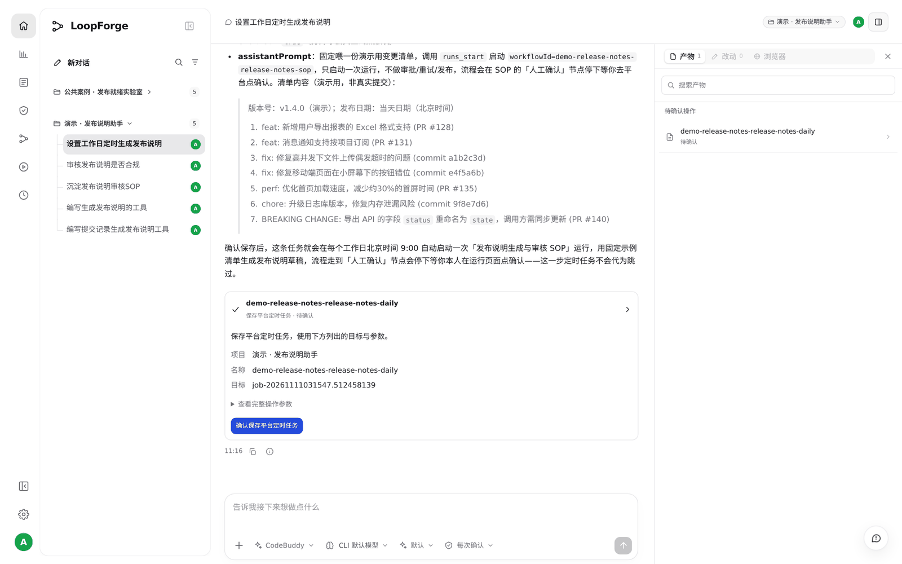
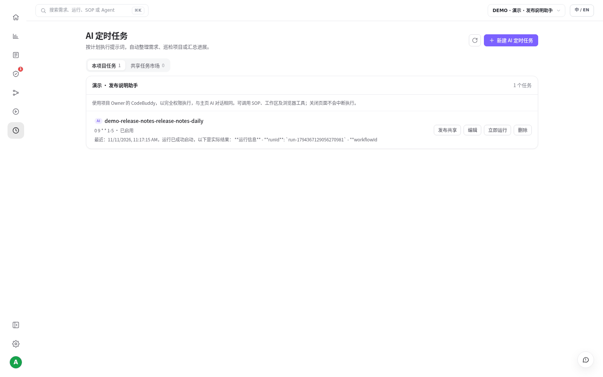
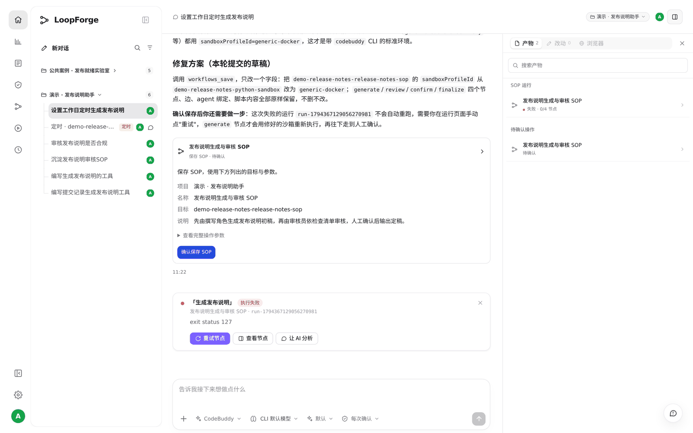
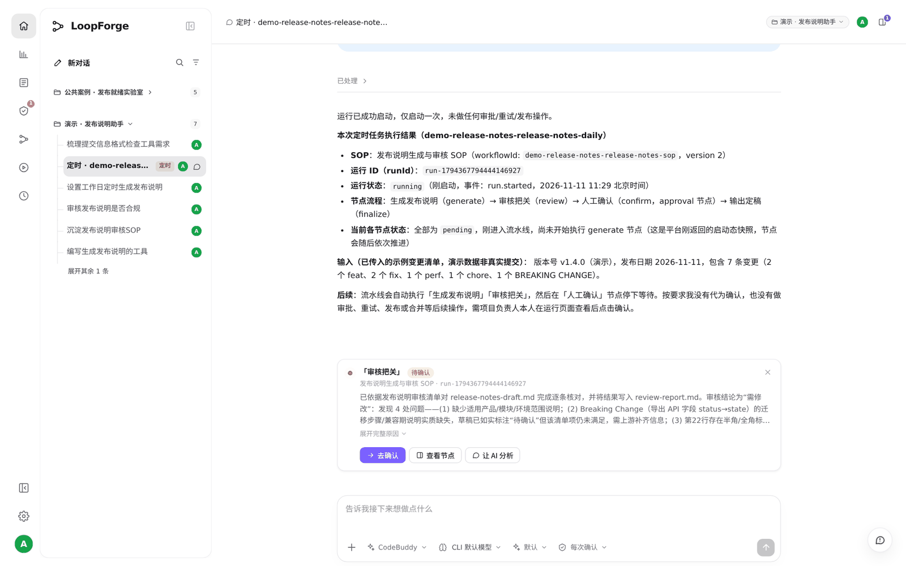
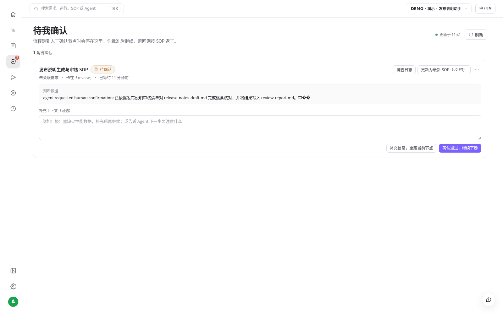

# S05 · 定时任务，7×24 小时自动跑

> **真实场景 · S05** · 一句话设好定时任务，到点自动启动 SOP；关掉页面也照跑，需要人的地方停下来等你。

## 能帮你什么

* **7×24 小时运行**：到点自动启动，不用记着、不用开着电脑。
* **自动和人工分开**：机器把能做的做完，需要拍板的地方停下来等人。
* **出了问题能查能修**：运行失败时，直接在对话里让 AI 分析原因并修复。

## 怎么用

### 1. 一句话设定时任务

```text
帮我设个定时任务：每个工作日早上 9 点自动跑一次「发布说明生成与审核 SOP」，
把前一天的提交整理成发布说明。
```

AI 先检查了现状，提醒我们：项目没接代码仓库，定时任务拿不到"前一天的提交"。我们回答：

```text
先不接仓库，演示用。
输入先放一份示例提交清单就行，到点能自动跑起来、停在人工确认等我就可以。
```

AI 给出配置（`0 9 * * 1-5`，北京时间每个工作日 9:00）和示例输入，弹出确认卡片：





确认后，左侧 **AI 定时任务** 里就有了这个任务。页面上写着：**关闭页面不会中断执行**。





### 2. 跑失败了？让 AI 查

第一次试跑失败了。我们直接在原对话里说：

```text
刚才那次运行失败了，帮我看看怎么回事，能修就修一下。
```

AI 读了运行日志，找到原因：SOP 绑的沙箱里没装 AI 执行器（`codebuddy: not found`）。它提交修复（改回平台默认沙箱），确认后重新启动了一次运行，这次正常跑完。





### 3. 到点自动跑，停下来等你

在定时任务页点 **立即运行**，效果和到点触发一样。每次触发会生成一个带「定时」标签的会话，里面记着启动了哪次运行。这次审核员发现了 4 处问题，运行停下来等人决定：





左侧 **待我确认** 也会出现这条，可以补充说明后放行，或者让它重跑：





## 适合什么时候用

* 每天、每周固定要做的事：整理发布说明、巡检、汇总进展、PR 审查。
* 想让 AI 在晚上和周末也干活，第二天来看结果。

## 实测

| 项目 | 结果 |
| --- | --- |
| 设置 | 3 句话，1 次确认，`0 9 * * 1-5` |
| 第一次试跑 | 失败（沙箱缺 AI 执行器），AI 定位原因并修复 SOP |
| 修复后 | 一次运行人工确认后 4 个节点全部完成；「立即运行」触发的一次停在审核等人 |

## 注意

* 定时任务用项目 Owner 的模型凭据执行。
* 定时任务只负责启动，不会替你审批。
* 已经失败的运行会固定使用当时的配置，修好 SOP 后要新启动一次。

---

← 上一篇：[S04 · 用 @ 调用团队资产](04-mention-assets.md) | [返回文档总目录](../README.md) | 下一篇：[S06 · 看用量和交付](06-usage-and-delivery.md) →
