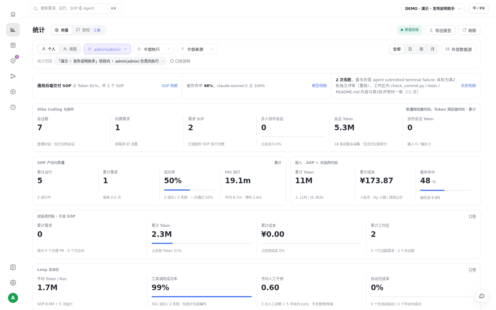
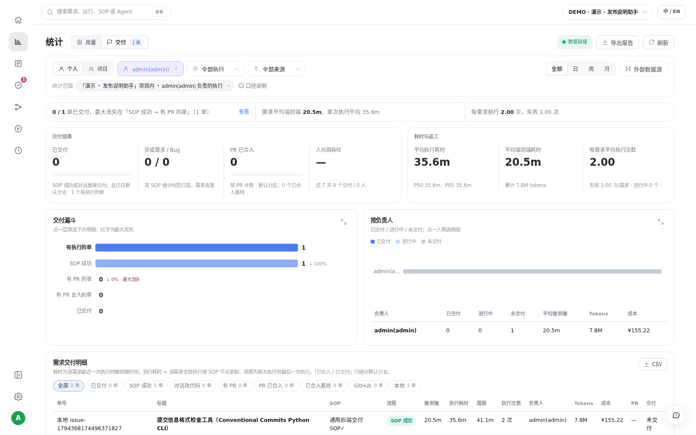

# S06 · 看用量和交付

> **真实场景 · S06** · 一个页面看清：开了多少会话、建了多少需求、跑了多少 SOP、花了多少 Token、交付了什么。

## 能帮你什么

* **花了多少一目了然**：Token、成本估算、缓存命中，按项目、成员、SOP 拆开。
* **交付了什么有数**：需求数、SOP 成功率、运行耗时、失败在哪。
* **能找到问题**：失败最多的是哪一步，一眼看到，点进去查明细。

## 怎么用

左侧导航点 **统计**，选好项目和时间范围。下面是演示项目 8 个场景全部跑完后的样子：

顶部可以切换：

* **用量 / 交付**：花了多少，和做成了什么，分开看。
* **个人 / 项目**：只看自己负责的，或者看整个项目。
* **日 / 周 / 月**：看趋势。

切到 **交付**，看到的是"做成了什么"：

这正是交付页的用处：它不会因为 SOP 跑成功就算交付，只有代码真正合入默认分支才算。演示项目没接仓库，所以它如实告诉你"卡在 PR 这一步"。

## 读数时注意

1. **"未采集"不等于 0**：页面会单独标出没采集到的部分，不会当 0 算。
2. **对话和 SOP 的用量分开展示**，不要直接相加当总花费。
3. **共享会话的用量**是整个会话的，不等于某个人的账单。

## 适合什么时候用

* 周会、月度复盘：团队这段时间用 AI 做了多少事、花了多少。
* 发现某个 SOP 老失败或特别贵，想定位原因。

---

← 上一篇：[S05 · 定时任务，7×24 小时自动跑](05-scheduled-jobs.md) | [返回文档总目录](../README.md) | 下一篇：[S07 · 在本地 IDE 里用平台](07-local-ide-mcp.md) →
