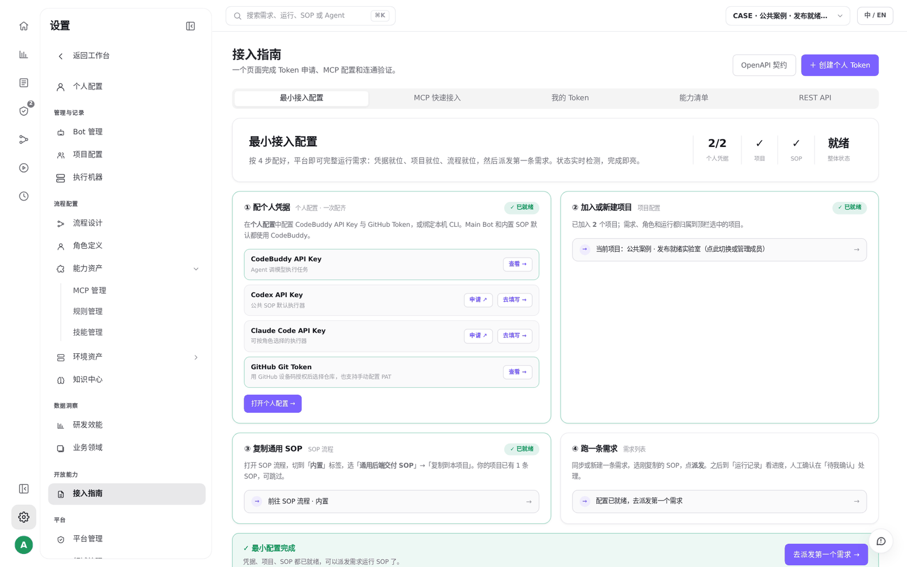
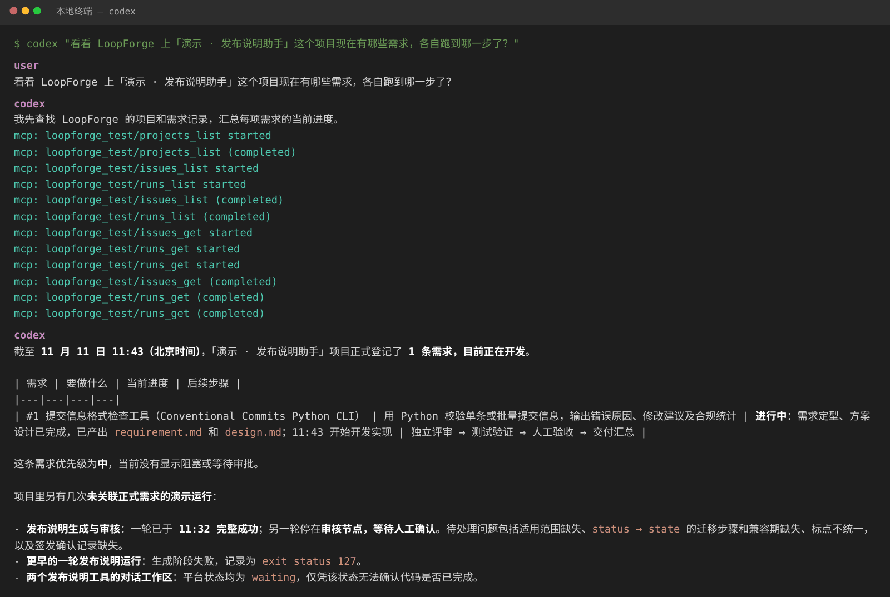

# S07 · 在本地 IDE 里用平台

> **真实场景 · S07** · 把本地的 Codex、Cursor、Claude Code、CodeBuddy 通过 MCP 接到 LoopForge，不开网页也能查进度、派任务。

## 能帮你什么

* **不离开你的编辑器**：在本地终端或 IDE 里直接问项目进展、看需求、启动 SOP。
* **本地和云端打通**：本地写代码，重活交给云端的 SOP 跑。
* **用自然语言**：不用记接口，直接问。

## 怎么用

### 1. 打开接入指南，创建个人 Token

**设置 → 接入指南**。页面会检查你的凭据和项目，并给出 MCP 配置。点 **「创建个人 Token」**。





### 2. 加到本地客户端配置

只新增 LoopForge 这一项，保留其他 MCP。

Codex（`~/.codex/config.toml`）：

```toml
[mcp_servers.loopforge]
url = "https://<你的 LoopForge 地址>/mcp"
http_headers = { Authorization = "Bearer <你的个人 Token>" }
```

Cursor / CodeBuddy（用户级 JSON）：

```json
{
  "mcpServers": {
    "loopforge": {
      "type": "streamable-http",
      "url": "https://<你的 LoopForge 地址>/mcp",
      "headers": { "Authorization": "Bearer <你的个人 Token>" }
    }
  }
}
```

### 3. 直接问

重启客户端后，在本地 Codex 里我们问的是：

```text
看看 LoopForge 上「演示 · 发布说明助手」这个项目现在有哪些需求，各自跑到哪一步了？
```

Codex 自己调用了 LoopForge 的工具（查项目、查需求、查运行），汇总成一张表：1 条需求正在开发、已完成哪几步、接下来是什么；还列出了其他运行的状态，包括哪次在等人确认、哪次失败了。





## 适合什么时候用

* 习惯在终端或 IDE 里工作，不想来回切网页。
* 想在本地脚本或自动化里查询、启动平台上的流程。

## 注意

| 报错 | 先检查 |
| --- | --- |
| 401 | 个人 Token 是否正确，是否带 `Bearer ` 前缀 |
| 404 | 地址是否以 `/mcp` 结尾 |
| 301 | 改用同域名的 `https://` 地址 |
| 看不到新工具 | 配置语法，然后重启客户端 |

* 个人 Token 只放在本地配置里，不要写进代码仓库或截图。

---

← 上一篇：[S06 · 看用量和交付](06-usage-and-delivery.md) | [返回文档总目录](../README.md) | 下一篇：[S08 · 对话里理清需求，交给 SOP 跑完](08-requirement-through-sop.md) →
