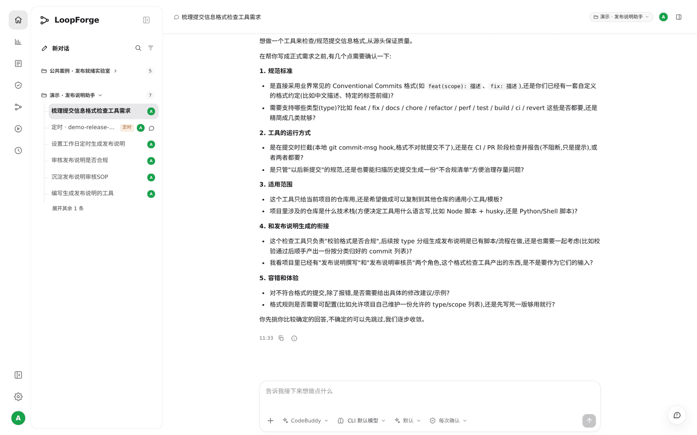
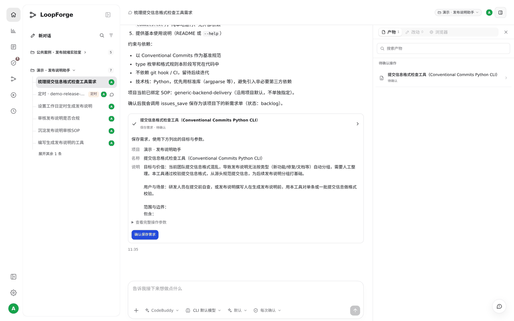
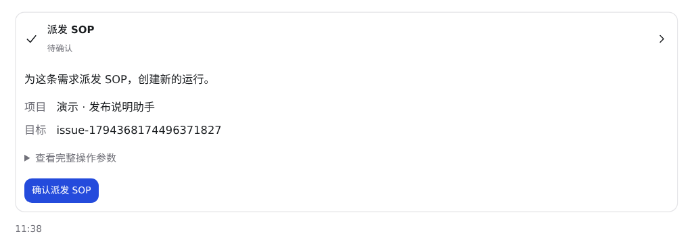
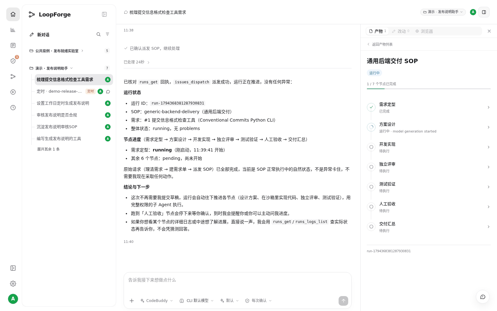
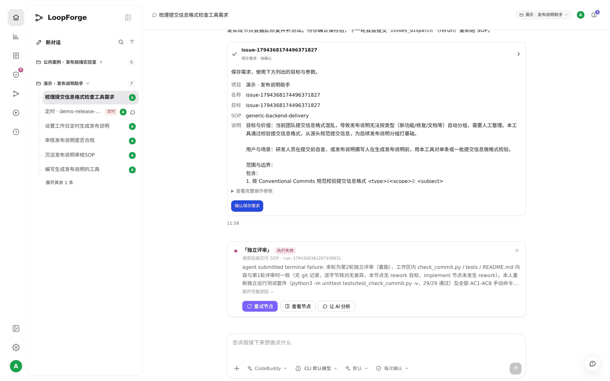
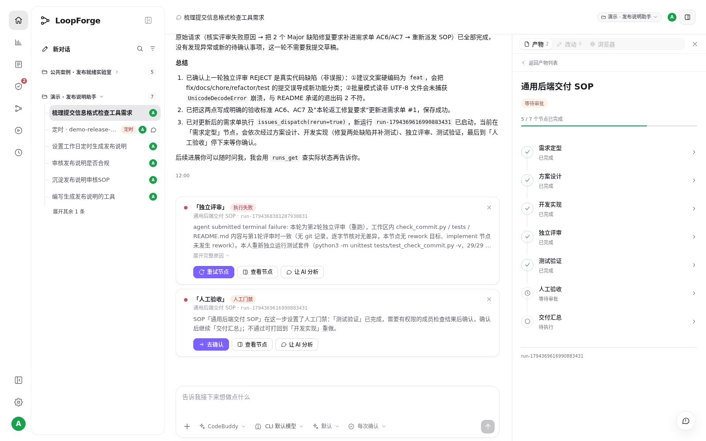
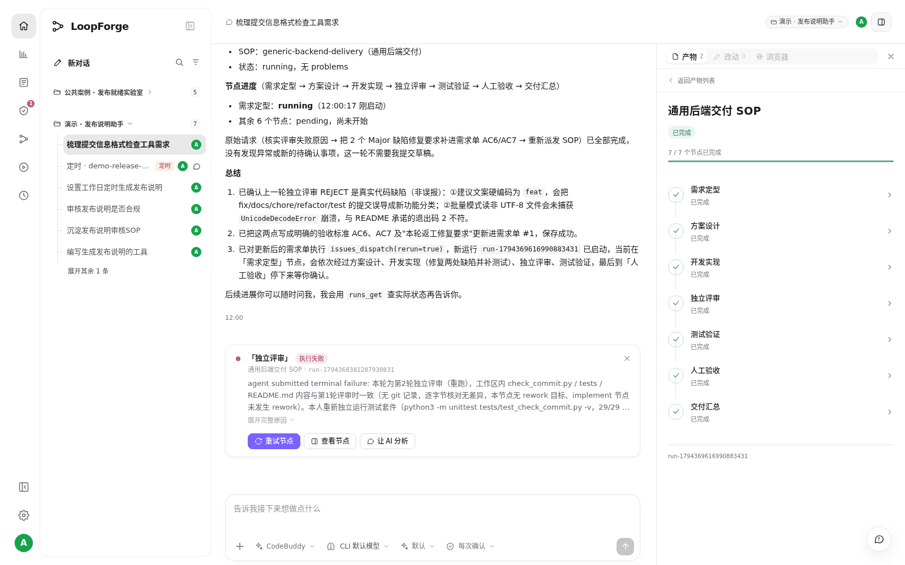
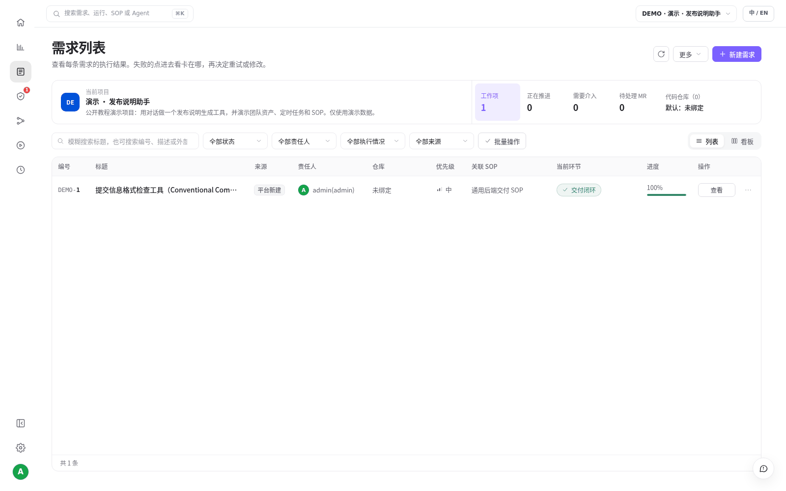

# S08 · 对话里理清需求，交给 SOP 跑完

> **真实场景 · S08** · 先和 AI 把需求聊清楚，它自动建好需求单；再从同一个对话发起 SOP，在侧边栏里看着它一步步跑完。

## 能帮你什么

* **想法变需求**：你只说个大概，AI 逐条反问，聊完自动整理成带验收标准的需求单。
* **一句话发起 SOP**：不用去别的页面配置，在对话里说"跑一下"。
* **过程实时可见**：会话右侧边栏显示每个节点的状态，跑到哪一步一清二楚。
* **质量有人把关**：独立评审节点会真的找问题，不合格就不放过；关键一步由人拍板。

## 怎么用

### 1. 说个大概，让 AI 反问

```text
最近大家提交信息写得很乱，发布说明经常分不了组。
想做个检查提交信息格式的小工具，你先帮我把需求理一理，有不清楚的问我。
```

AI 从规范、运行方式、适用范围、和发布说明的衔接、容错 5 个方面提问：





### 2. 简单回答，让它建单

```text
就用 Conventional Commits，类型 feat/fix/docs/chore/refactor/test 够了。
先做成 Python 命令行，能检查一条或一批提交信息，不合规的给出修改建议。
hook 和 CI 以后再说。
不用扫历史。
规则先写死。
理清楚了就建个需求单。
```

AI 把回答整理成目标、范围、验收标准和约束，弹出 **「保存需求」** 卡片；右侧边栏同时显示待确认操作。点确认，需求单就进了 **需求列表**。





### 3. 一句话发起 SOP

```text
用通用后端交付 SOP 跑一下这个需求。
```

AI 提醒项目还没接代码仓库。我们回答：

```text
不用仓库，先在沙箱里做出来就行，直接派发吧。
```

AI 弹出 **「派发 SOP」** 卡片，确认后运行就开始了。





### 4. 在侧边栏看执行过程

点对话右上角的按钮打开侧边栏，「SOP 运行」里就是这次运行。点进去能看到 7 个节点逐个推进：





### 5. 评审没过？补进需求再跑

第一次运行到 **独立评审** 时被拦下了：评审重新跑了测试，确认 29 个测试都是真的通过，但发现了 2 个真实缺陷（修改建议总是写成 `feat`；非 UTF-8 文件会直接崩溃）。对话里同时出现了失败卡片：





我们只说了一句：

```text
评审没通过，你看下是什么问题，把要修的点补进需求再跑一次。
```

AI 把 2 个缺陷写成新的验收标准补进需求单，确认后重新派发。

### 6. 人工验收，完成

重跑时 AI 按补充后的验收标准重新设计和实现。这次评审和测试都通过了：31 个测试全部通过，2 个缺陷都确认修好；评审另外记了 2 个不影响使用的小问题，留给下次迭代。

运行停在 **人工验收**，侧边栏显示 5/7 节点完成，对话里出现「去确认」卡片：





点 **「去确认」**，在运行页点 **「确认通过，继续下游」**。「交付汇总」节点再独立复验一遍并写好交付报告，运行完成：





需求列表里，这条需求显示「交付闭环」，进度 100%：





## 实测

| 项目 | 结果 |
| --- | --- |
| 你说的话 | 5 句，最长的一句是回答 AI 的问题 |
| 你点的确认 | 建单、派发、更新需求、重新派发、人工验收 |
| 第一次运行 | 约 17 分钟，在独立评审被拦下：29 个测试都通过，但有 2 个真实缺陷 |
| 补需求后重跑 | 约 20 分钟，7/7 节点完成，31 个测试通过 |

## 适合什么时候用

* 需求还模糊，想先聊清楚再动手。
* 正式需求，需要方案、评审、测试和人工验收这些固定步骤。
* 想让需求、运行、产物串成一条线，之后能回查。

## 注意

* SOP 每次都在新的沙箱里运行，看不到对话工作区里的文件。要基于已有代码改，先给项目接代码仓库。
* 内置的通用 SOP 评审不通过时不会自动打回，需要你（或让 AI）把问题补进需求后重新派发。
* 人工验收由你点，不会被跳过。

---

← 上一篇：[S07 · 在本地 IDE 里用平台](07-local-ide-mcp.md) | [返回文档总目录](../README.md)
